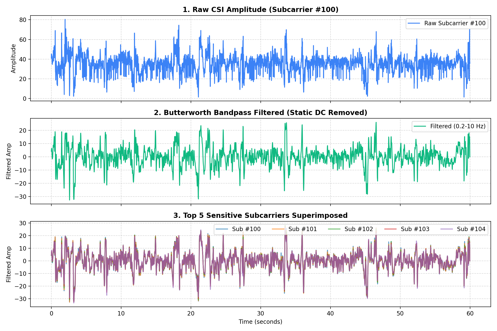

# 📡 Wi-Sense AI — Device-Free Human Activity & Presence Sensing Using Wi-Fi CSI

[](file:///e:/Vli/PROJECTS/Project%202%20-%20wifi%20sensing/HANDOVER.md)
[](https://github.com/espressif/esp-idf)
[](https://python.org)
[](file:///e:/Vli/PROJECTS/Project%202%20-%20wifi%20sensing/TEAM_SETUP_AND_STATUS_REPORT.md)
[-100%25%20Complete-success.svg)](#role-1-embedded--csi-systems-engineer--ali-sakr)

---

## 📌 Executive Summary & Project Scope

**Wi-Sense AI** is a graduation research project that enables **device-free, non-invasive human activity recognition and indoor presence sensing** without cameras, wearables, or microphones. By measuring microscopic perturbations in Wi-Fi **Channel State Information (CSI)** between commodity microcontrollers, the system classifies human movements through physical space.

### Key Advantages
- 🔒 **Absolute Visual Privacy:** Operates strictly using RF physical layer subcarrier multipath reflections. No images or audio captured.
- 🌙 **Environment Agnostic:** Functions flawlessly in total darkness, through smoke, steam, and non-metallic partition walls.
- 🏷️ **Zero Wearables:** Targets need not carry any smartphone, tag, or sensor.
- 💰 **Ultra Low Cost:** Built on commodity **ESP32** microcontrollers ($4 each) and standard Wi-Fi routers.

---

## 🏛️ System Architecture

```mermaid
flowchart LR
    A["Ali Board (TX)<br/>ESP32 NodeMCU-32S<br/>(ESP-NOW 60Hz, Ch11)"] -->|"Multipath RF Distortions<br/>(Human Body Reflections)"| B["Sabi Board (RX)<br/>ESP32 NodeMCU-32S<br/>(CSI Promiscuous Sniffer)"]
    B -->|"Wi-Fi STA (UDP Port 9000)<br/>58.8 pkt/s Unicast"| C["Dedicated TEData Router<br/>(Project_CSI_Router)<br/>192.168.2.1"]
    C -->|"100 Mbps Ethernet<br/>Isolated CSI Subnet"| D["Host PC / Laptop<br/>(192.168.2.2:9000)<br/>Dual-Network Protected"]
    D --> E["CSI Sensing Studio<br/>tools/csi_dashboard.py<br/>(Tailwind v4 UI, Port 8080)"]
    E --> F["Role 2 & 3 ML Pipeline<br/>Preprocessing, Features &<br/>Activity Classification"]
```



---

## 👥 Team Roles & Responsibilities Matrix

| Role | Domain | Lead | Status | Primary Output |
| :--- | :--- | :--- | :---: | :--- |
| **Role 1** | **Embedded & CSI Systems** | **Ali Sakr** | 🟢 **100% Complete** | Hardware firmware, UDP transport, Dashboard visualizer, Multi-activity baseline datasets |
| **Role 2** | **Signal Processing & Denoising** | *Teammate 1* | 🟡 **Ready to Start** | Bandpass filtering (0.2–10 Hz), phase sanitization, STFT Doppler spectrograms |
| **Role 3** | **Machine Learning & Deep Learning** | *Teammate 2* | ⚪ **Ready to Start** | Windowing, feature extraction, activity classifier (Random Forest, SVM, 1D-CNN) |
| **Role 4** | **Real-Time Integration & UI** | *Teammate 3* | ⚪ **Ready to Start** | Live model inference in web studio, activity detection badges, intrusion alerts |
| **Role 5** | **Evaluation & Thesis Documentation** | *Teammate 4* | ⚪ **Ready to Start** | Geometry benchmarking (LoS vs NLoS), multi-subject tests, graduation book & IEEE paper |

---

### Detailed Role Specifications

#### 🟢 Role 1: Embedded & CSI Systems Engineer — Ali Sakr (COMPLETED)
- **Status:** **100% Hardware-Verified & Certified.**
- **Completed Deliverables:**
  1. **Transmitter Node ("Ali Board"):** ESP32 configured with ESP-IDF v5.4.4 transmitting ESP-NOW frames at **60 Hz** on Channel 11 (HT20 bandwidth). Powered autonomously from any 5V USB power bank with no PC data link required.
  2. **Receiver Node ("Sabi Board"):** ESP32 configured with promiscuous CSI capture, extracting 128 complex subcarrier values and streaming UDP packets to the host PC on port 9000.
  3. **High-Speed UDP Transport:** Proven **99.8% packet delivery rate** with a median jitter of 1.29 ms, resolving USB-serial UART bottleneck.
  4. **Dual-Network Isolation:** Automated scripts (`tools/fix_csi_network.bat`) assigning static IP `192.168.2.2` with zero default gateway, keeping host home Wi-Fi Internet intact.
  5. **CSI Sensing Studio Web Dashboard:** Standalone HTTP server (`tools/csi_dashboard.py` on port 8080) with Tailwind CSS v4, live 128-subcarrier visualizer, instant dataset recorder, and file analyzer.
  6. **Certified Baseline Datasets:** Recorded and audited 5 multi-activity datasets (`empty_room`, `person_sitting`, `person_walking`, `hand_wave`) totaling over 17,500 frames with 0 corruptions.

---

#### 🟡 Role 2: Signal Processing & Denoising Engineer (Teammate Task)
- **Objective:** Convert raw, noisy CSI amplitude and phase into clean, human-movement-specific signal representations.
- **Assigned Deliverables:**
  1. **Impulsive Noise Removal:** Implement Hampel filtering or moving median filtering across subcarriers.
  2. **Human Motion Bandpass Filter:** Apply a 4th-order Butterworth bandpass filter (0.2 Hz – 10.0 Hz) to eliminate static room reflections (0 Hz DC offset) and high-frequency noise. *(Starter script provided in `tools/preprocess_csi.py`)*.
  3. **Phase Sanitization:** Unwrap raw phase measurements and apply linear transformation to remove carrier frequency offset (CFO) and sampling time offset (STO).
  4. **Subcarrier Selection:** Implement variance-based ranking or Principal Component Analysis (PCA) to extract the top-5 most motion-sensitive subcarrier streams.
  5. **Doppler Spectrograms:** Compute Short-Time Fourier Transform (STFT) to produce time-frequency representations of limb and torso velocities.

---

#### ⚪ Role 3: Machine Learning & Deep Learning Engineer (Teammate Task)
- **Objective:** Train, optimize, and validate machine learning models to classify human activities from preprocessed CSI features.
- **Assigned Deliverables:**
  1. **Window Segmentation:** Slice preprocessed streams into sliding windows (1.0 s to 2.0 s duration, 50% overlap).
  2. **Feature Engineering (`tools/extract_features.py`):**
     - *Time Domain:* Mean, variance, standard deviation, skewness, kurtosis, interquartile range (IQR), normalized signal energy.
     - *Frequency Domain:* Spectral entropy, dominant Doppler shift frequency, spectral centroid, energy in sub-bands (0.2–2 Hz for torso, 2–8 Hz for limbs).
  3. **Model Development (`tools/train_classifier.py`):**
     - Train baseline classical models: Random Forest, Support Vector Machine (RBF kernel), and LightGBM / XGBoost.
     - Optional Deep Learning: 1D-CNN or CNN-BiLSTM for end-to-end spectrogram classification.
  4. **Validation & Metrics:** 5-fold stratified cross-validation, confusion matrices, precision, recall, and F1-score benchmarks.

---

#### ⚪ Role 4: Real-Time Systems Integration & Application Engineer (Teammate Task)
- **Objective:** Connect the trained ML model back into the live web dashboard for real-time activity recognition and presence alarming.
- **Assigned Deliverables:**
  1. **Streaming Inference Engine:** Add a real-time sliding buffer to `tools/csi_dashboard.py` that evaluates the trained model every 250 ms.
  2. **UI Enhancements:** Display active prediction badges (`WALKING (98%)`, `SITTING (94%)`, `EMPTY (99%)`) live in the web browser.
  3. **Intruder / Fall Detection Alerting:** Add threshold-based alert triggers when sudden high-energy motion or unexpected presence is detected.
  4. **Cross-Platform Deployment:** Package the dashboard into a standalone executable or Docker container for edge devices (e.g., Raspberry Pi 4).

---

#### ⚪ Role 5: Experimental Evaluation, Field Testing & Academic Documentation Lead (Teammate Task)
- **Objective:** Rigorously validate system performance under diverse environments and author the academic graduation book.
- **Assigned Deliverables:**
  1. **Room Geometry & Environmental Testing:**
     - Line-of-Sight (LoS) vs. Non-Line-of-Sight (NLoS) evaluation.
     - Through-wall sensing test (TX outside room, RX inside).
     - Multi-subject variation tests (different body masses, walking speeds, orientations).
  2. **Academic Publication & Thesis Drafting:**
     - Prepare graduation project documentation following official university guidelines.
     - Format IEEE-style conference paper with high-resolution signal plots and confusion matrices.
     - Prepare presentation slides and live demonstration walkthrough for the examination committee.

---

## 🚀 Teammate Quick-Start Guide (Fast Handover)

Follow these steps to run the live sensing setup or develop signal processing algorithms:

### 1. Clone & Set Up Environment
```bash
git clone https://github.com/AliSakr9997/wifi-csi-human-sensing.git
cd wifi-csi-human-sensing

# Install Python dependencies
pip install -r requirements.txt
```

### 2. Connect the Physical Hardware
1. **Router:** Power on the dedicated router (`Project_CSI_Router`). Connect an Ethernet cable from **LAN 1** into your laptop.
2. **Ali Board (TX):** Plug into any 5V USB wall adapter or portable power bank anywhere in the room.
3. **Sabi Board (RX):** Plug into your laptop via Micro-USB (COM port).
4. **Network Optimizer (Run once as Admin):**
   - Right-click `tools/fix_csi_network.bat` and select **"Run as administrator"**.
   - *(Locks Ethernet to static 192.168.2.2 with no gateway, keeping home Wi-Fi Internet working!)*

### 3. Launch the Live Dashboard
```bash
python tools/csi_dashboard.py
```
Open your browser to: **[http://localhost:8080](http://localhost:8080)**. You will see live subcarrier amplitude dynamics streaming at ~58.8 pkt/s!

### 4. Test the Preprocessing Pipeline (Role 2)
You can immediately run the preprocessing filter on the existing recorded datasets:
```bash
python tools/preprocess_csi.py data/person_walking_20261024_035105.csv
```
This generates a multi-stage filtering plot saved to `docs/preprocessed_walking_example.png`:



---

## 📁 Repository Structure

```
├── data/                                 # Hardware-recorded activity datasets
│   ├── empty_room_20261024_035317.csv    # Empty room baseline
│   ├── person_sitting_20261024_034928.csv# Subtle stationary breathing / presence
│   ├── person_walking_20261024_035105.csv# Large multipath human locomotion
│   ├── hand_wave_20261024_035248.csv     # Localized arm gesture run 1
│   ├── hand_wave_20261024_040642.csv     # Localized arm gesture run 2
│   └── csi_udp_ht20_60hz.csv             # Baseline UDP transmission audit (99.8% delivery)
├── docs/                                 # Architectural specifications & plots
│   ├── m2-data-quality.md                # Milestone 2 hardware quality audit
│   └── preprocessed_walking_example.png  # Preprocessing signal plot
├── firmware/                             # ESP-IDF firmware patches
│   └── esp-csi-m3-udp.patch              # Complete diff for esp-csi repository
├── tools/                                # Production Python utilities & dashboards
│   ├── csi_dashboard.py                  # Live Tailwind CSS v4 Sensing Studio web app
│   ├── preprocess_csi.py                 # Butterworth bandpass & subcarrier filter (Role 2)
│   ├── audit_reliability.py              # Sequence, jitter, and packet delivery auditor
│   ├── fix_csi_network.bat               # Windows 1-click dual-network optimizer (Admin)
│   ├── fix_csi_network.ps1               # PowerShell network optimizer script
│   └── tailwind.js                       # Local offline Tailwind CSS runtime
├── build_flash_recv.bat                  # 1-click ESP-IDF build & flash helper for Sabi Board
├── HANDOVER.md                           # Detailed engineering handover notes
├── TEAM_SETUP_AND_STATUS_REPORT.md       # Teammate router setup & technical status report
└── requirements.txt                      # Python dependencies
```

---

## 📜 Firmware Details

- **ESP-IDF Version:** v5.4.4 (Classic ESP32 target)
- **Wi-Fi Mode:** 2.4 GHz HT20 (20 MHz channel width), MCS0 rate
- **Channel:** Channel 11 (Fixed)
- **Transmit Protocol:** ESP-NOW 60 Hz (`1a:00:00:00:00:00`)
- **Transport:** UDP Unicast to `192.168.2.2:9000` via AP `Project_CSI_Router`

To flash Sabi Board (RX) from clean clone:
```bash
# Apply patch to external esp-csi repo
cd firmware/esp-csi
git apply ../esp-csi-m3-udp.patch

# Build and flash using the automated helper
cd ../..
build_flash_recv.bat
```

---

## 🏆 Project Contributors & Graduation Team

- **Ali Sakr** ([@AliSakr9997](https://github.com/AliSakr9997)) — *Role 1 Lead: Embedded Systems, Firmware & CSI Acquisition*
- **Mohammed Sabry** — *Role 2 Lead: Signal Processing, Noise Filtering & Feature Engineering*
- *Teammates (Roles 3, 4, 5)*

---
*Developed as part of the Senior Graduation Project on Ambient AI Sensing.*
